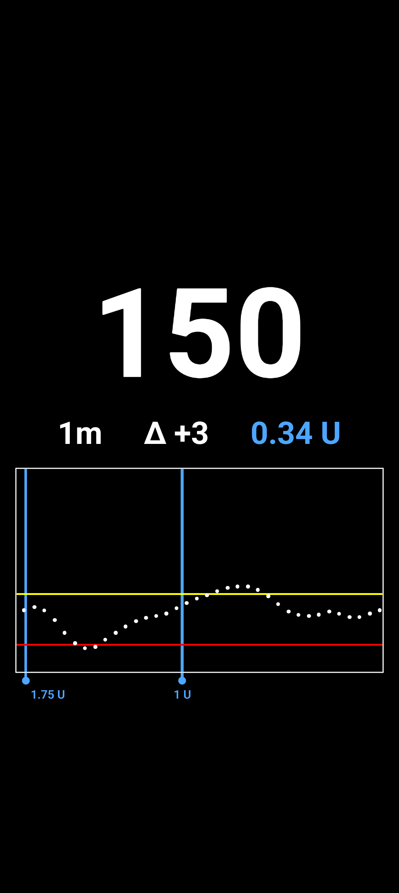

# Glucose Display

This is a small utility application I have made to easily see my blood sugar at a glance while driving my car. It provides a focused display using data from xDrip or Nightscout.

Originally called "Car GLucose Display", the app also proved useful at the gym and while studying. Its clean display keeps glucose information visible while keeping the screen awake.



## Features

- Large glucose reading in mg/dL or mmol/L
- Optional reading age, delta, trend arrows or even insulin on board
- Customizable glucose history graph
- Configurable layout and dimensions
- Options to keep the screen awake and hide system UI

## Installation

A prebuilt APK can be found in the [releases](https://github.com/jonatfm/glucose-display-app/releases)

## Setup

Hold anywhere on the main display for one second to open the settings

### xDrip

1. Enable xDrips local web service in the app
2. Select xDrip as the source
3. Use `http://127.0.0.1:17580` when xDrip runs on the same phone
4. Test the connection and save the configuration

Showing IOB requires that option enabled in xDrip.

### Nightscout

1. Select Nightscout as the source
2. Enter your Nightscout HTTPS address
3. Select public access or enter a read-only access token
4. Test the connection and save the configuration

### Other

Other data-connectors should be easy to integrate into this app, feel free to open a pull request.

## Development

Built with React Native, Expo, and TypeScript.

With Node.js, pnpm, Java, and the Android SDK installed:

```sh
pnpm install
pnpm android
```
